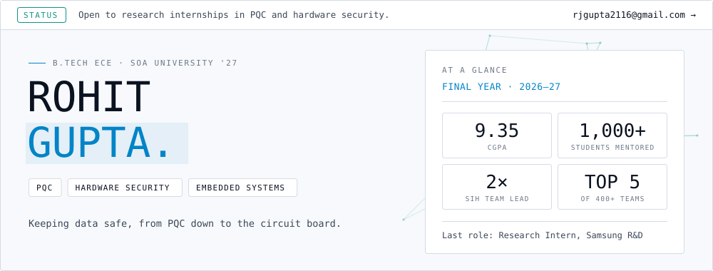
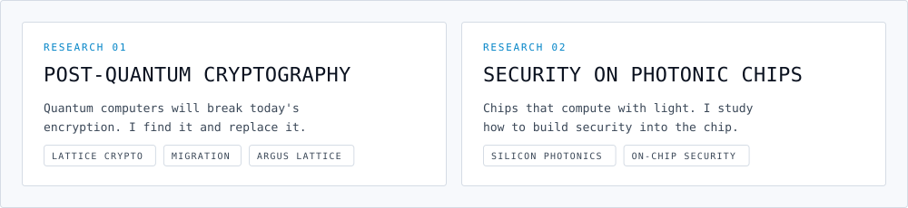
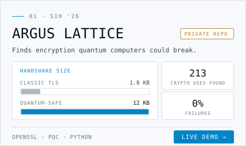
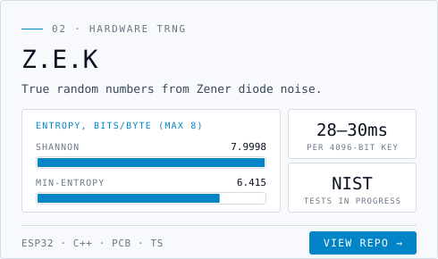
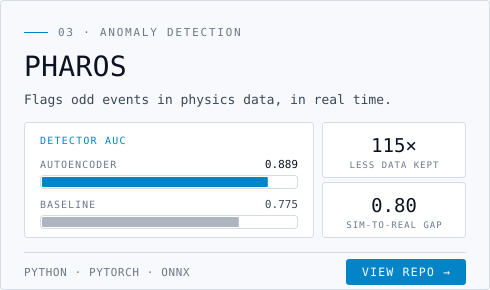
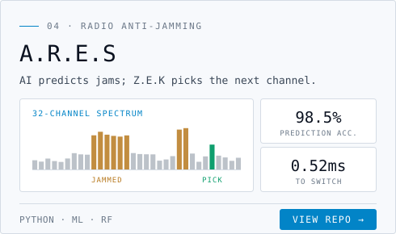
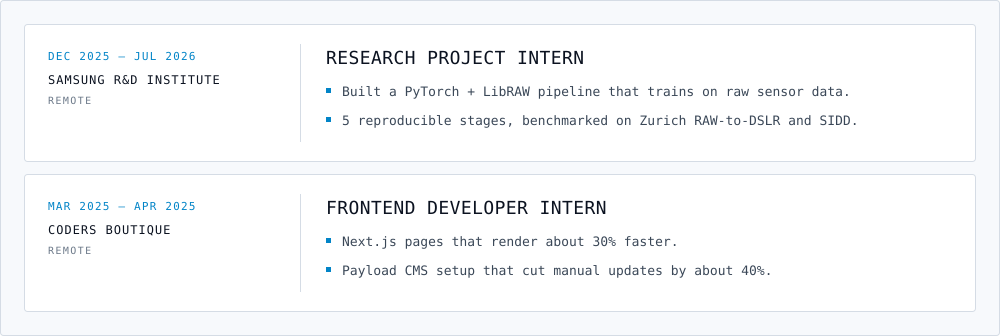
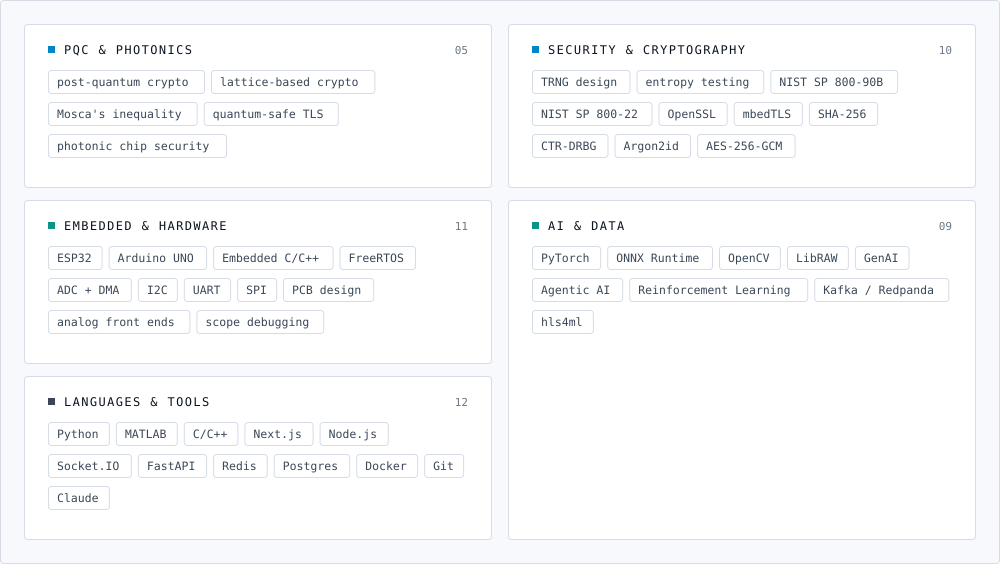
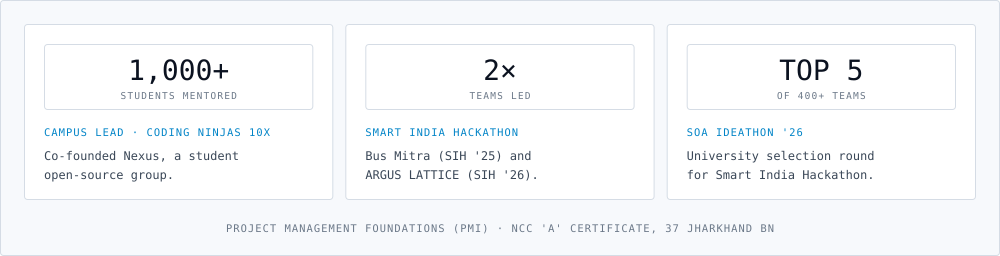
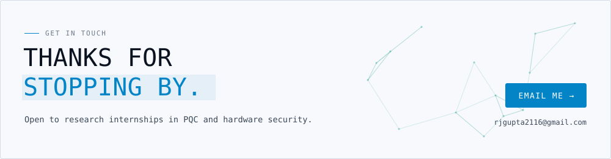

<picture><source media="(prefers-color-scheme: dark)" srcset="./header-dark.svg"></picture>

  

<picture><source media="(prefers-color-scheme: dark)" srcset="./h-research-dark.svg"></picture>
<picture><source media="(prefers-color-scheme: dark)" srcset="./research-dark.svg"></picture>

  

<picture><source media="(prefers-color-scheme: dark)" srcset="./h-projects-dark.svg"></picture>

<a href="https://arguslattice.vercel.app"><picture><source media="(prefers-color-scheme: dark)" srcset="./p-argus-dark.svg"></picture></a>
<a href="https://github.com/Rohit-Gupta-126/zek_eaas"><picture><source media="(prefers-color-scheme: dark)" srcset="./p-zek-dark.svg"></picture></a>
<a href="https://github.com/Rohit-Gupta-126/PHAROS"><picture><source media="(prefers-color-scheme: dark)" srcset="./p-pharos-dark.svg"></picture></a>
<a href="https://github.com/Rohit-Gupta-126/ARES_Cognitive_RF"><picture><source media="(prefers-color-scheme: dark)" srcset="./p-ares-dark.svg"></picture></a>

Click a card to open the project. ARGUS LATTICE is a private repo, so it opens the live demo.

  

<picture><source media="(prefers-color-scheme: dark)" srcset="./h-exp-dark.svg"></picture>
<picture><source media="(prefers-color-scheme: dark)" srcset="./experience-dark.svg"></picture>

  

<picture><source media="(prefers-color-scheme: dark)" srcset="./h-skills-dark.svg"></picture>
<picture><source media="(prefers-color-scheme: dark)" srcset="./skills-dark.svg"></picture>

  

<picture><source media="(prefers-color-scheme: dark)" srcset="./h-outside-dark.svg"></picture>
<picture><source media="(prefers-color-scheme: dark)" srcset="./outside-dark.svg"></picture>

  

<picture><source media="(prefers-color-scheme: dark)" srcset="./h-stats-dark.svg"></picture>

<b>COMMIT CALENDAR</b> 

  
<picture><source media="(prefers-color-scheme: dark)" srcset="https://raw.githubusercontent.com/Rohit-Gupta-126/Rohit-Gupta-126/output/github-contribution-grid-snake-dark.svg"></picture>
  
<picture><source media="(prefers-color-scheme: dark)" srcset="https://github-profile-summary-cards.vercel.app/api/cards/profile-details?username=Rohit-Gupta-126&theme=github_dark"></picture>

<picture><source media="(prefers-color-scheme: dark)" srcset="https://github-readme-stats.vercel.app/api?username=Rohit-Gupta-126&show_icons=true&hide=issues&border_radius=3&bg_color=05070B&title_color=38BDF8&text_color=E8EDF5&icon_color=2DD4BF&border_color=18202D"></picture>
<picture><source media="(prefers-color-scheme: dark)" srcset="https://github-readme-stats.vercel.app/api/top-langs/?username=Rohit-Gupta-126&layout=compact&langs_count=8&border_radius=3&bg_color=05070B&title_color=38BDF8&text_color=E8EDF5&border_color=18202D"></picture>
<picture><source media="(prefers-color-scheme: dark)" srcset="https://github-profile-summary-cards.vercel.app/api/cards/repos-per-language?username=Rohit-Gupta-126&theme=github_dark"></picture>
<picture><source media="(prefers-color-scheme: dark)" srcset="https://github-profile-summary-cards.vercel.app/api/cards/most-commit-language?username=Rohit-Gupta-126&theme=github_dark"></picture>
<picture><source media="(prefers-color-scheme: dark)" srcset="https://github-profile-summary-cards.vercel.app/api/cards/productive-time?username=Rohit-Gupta-126&theme=github_dark"></picture>

<picture><source media="(prefers-color-scheme: dark)" srcset="https://streak-stats.demolab.com/?user=Rohit-Gupta-126&border_radius=3&background=05070B&border=18202D&stroke=18202D&ring=38BDF8&fire=2DD4BF&currStreakNum=E8EDF5&sideNums=E8EDF5&currStreakLabel=38BDF8&sideLabels=6B7888&dates=6B7888"></picture>
<picture><source media="(prefers-color-scheme: dark)" srcset="https://github-readme-activity-graph.vercel.app/graph?username=Rohit-Gupta-126&bg_color=05070B&color=6B7888&line=38BDF8&point=2DD4BF&area=true&area_color=38BDF8&hide_border=false&border_color=18202D&radius=3&title_color=38BDF8"></picture>

  
<a href="mailto:rjgupta2116@gmail.com"><picture><source media="(prefers-color-scheme: dark)" srcset="./footer-dark.svg"></picture></a>

