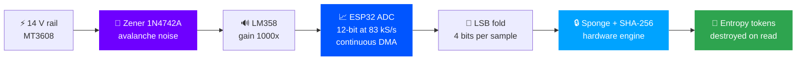
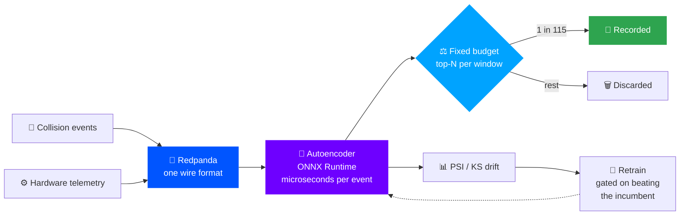

<h1 align="center">Namaste 🙏, I'm Rohit Gupta</h1>

<p align="center">
  <em>I work at the layer where <b>analog physics becomes digital code</b>.</em><br>
  <em>My projects start at a diode and end at an API.</em>
</p>

<p align="center">
  
  
  
</p>

<p align="center">
  <a href="https://linkedin.com/in/rohit-gupta126"></a>
  <a href="mailto:rjgupta2116@gmail.com"></a>
  <a href="https://github.com/Rohit-Gupta-126"></a>
  
</p>

---

<table align="center">
<tr>
<td align="center" width="25%"><h3>🔧</h3><b>Bare-metal C/C++</b><br><sub>ADC/DMA · FreeRTOS<br>I²C · UART · SPI</sub></td>
<td align="center" width="25%"><h3>📡</h3><b>Real-time pipelines</b><br><sub>µs scoring budgets<br>streaming telemetry</sub></td>
<td align="center" width="25%"><h3>🔐</h3><b>Hardware security</b><br><sub>TRNG · SP 800-90B<br>post-quantum crypto</sub></td>
<td align="center" width="25%"><h3>🔬</h3><b>Measured, not claimed</b><br><sub>if it isn't measured,<br>it isn't a result</sub></td>
</tr>
</table>

<p align="center">
🎓 B.Tech ECE, <b>SOA University 2027</b> &nbsp;·&nbsp; 🏢 Research Intern, <b>Samsung R&D Institute</b><br>
<sub>Currently: SP 800-90B campaign on Z.E.K v2 · closing the sim-to-real gap on PHAROS · ARM Cortex-M bring-up</sub>
</p>

---

<h2 align="center">⚡ Z.E.K — ZenTropy Key</h2>
<p align="center"><b>Randomness sourced from physics, not arithmetic.</b><br>
<sub>A Zener diode in avalanche breakdown → amplified → sampled → conditioned in firmware → served as destroy-on-read tokens.<br>
I designed the analog chain, laid out the board, and wrote every line of firmware and service code.</sub></p>

<p align="center">
  
  
  
  
  
  
  
  
</p>



<p align="center">
  
  
  
</p>

> **What I am not claiming.** v2 targets ~25 ms per 4096-bit key by design arithmetic — but that number stays unpublished until `ea_non_iid` confirms min-entropy at 20 / 40 / 83 kS/s. The LM358 gives roughly **1 kHz closed-loop bandwidth** at 1000× gain, so faster samples may be correlated. The measurement sets the spec, not the other way round.

<details>
<summary><b>🔍 Firmware v2 — engineering detail</b></summary>

<br>

| Technique | Implementation |
|---|---|
| **DMA capture** | ADC continuous mode at 83 kS/s replaces a 50 µs busy-wait — CPU free during conversion |
| **RTOS design** | Harvester task pinned to core 0 keeps a live pool charged; core 1 serves requests |
| **Bit extraction** | Configurable N-LSB folding instead of discarding 11 of every 12 converted bits |
| **Dual mode** | `MODE_FULL_PHYSICAL` (raw-backed) and `MODE_90C_EXPANDED` (physical seed → CTR-DRBG) |
| **Wire protocol** | Binary framing @ 921600 baud, runtime-tunable (`MODE`, `OSR`, `LSB`, `RATE`, `STAT`) |
| **Test hook** | `RAW <count>` streams samples into NIST `ea_non_iid` — assessment cut from hours to minutes |
| **Noise hygiene** | Radios off during harvest (RF modulates the ADC reference); I²C raised to 400 kHz |

**Service layer** — FastAPI + Redis (atomic `LPOP` = destroyed on serve) + Postgres, Argon2id-hardened hardware-seeded API keys, AES-256-GCM WebSocket telemetry with 10-minute key rotation, Next.js dashboard and admin console.

</details>

---

<h2 align="center">🔭 PHAROS — Real-Time Anomaly Recognition</h2>
<p align="center"><b>Learn what normal looks like, then notice in real time when something isn't.</b><br>
<sub>No labels, hard latency budget. Stream A scores collision events the way an LHC trigger would.<br>
Stream B watches real accelerator power-hardware waveforms for equipment that stopped looking healthy.<br>
Public data. One laptop.</sub></p>

<p align="center">
  
  
  
  
  
  
  
</p>



<p align="center">
  
  
  
  
</p>

<details>
<summary><b>🔍 The results that don't flatter</b></summary>

<br>

| Finding | Measurement |
|---|---|
| **FPGA fixed-point** | `ap_fixed<24,8>` needed for 100% trigger-decision agreement; `<16,6>` gave only 91% |
| **Sim-to-real gap** | KS = 0.80 against real CMS Open Data — measured, not fixed |
| **Hardware stream** | A statistical baseline *beat* the deep model (0.805 vs 0.711); root cause: preprocessing smoothed away the sharp transients the faults consist of |
| **Drift monitor** | Cannot separate benign calibration skew from genuine distribution shift |

**Engineering practice** — multi-phase `Makefile` (`make phase0` → `phase4`), Docker Compose orchestration, pytest smoke suite, single-command reproducible setup, and a design log recording the decisions that failed alongside the ones that worked.

</details>

---

<h2 align="center">📡 A.R.E.S — Autonomous Radio Evasion System</h2>
<p align="center"><b>AI predicts the jam. Physics picks the channel.</b><br>
<sub>Sequence models rank the safe channels; Z.E.K's hardware entropy makes the final pick —<br>
so the hop pattern carries no algorithmic structure for an adversary to learn.</sub></p>

<p align="center">
  
  
  
  
</p>

---

<h2 align="center">🛠️ Capability Map</h2>

<table>
<tr>
<td valign="top" width="50%">

**⚙️ Embedded & Firmware**
```
C · C++ · bare-metal register config
FreeRTOS · core pinning · ISR discipline
ADC continuous/DMA · I²C · UART · SPI
Custom binary wire protocols
PCB design · fabrication · bring-up
Scope / logic-analyser debug
Analog front ends · GBW analysis
EMI & noise-coupling mitigation
```

**🧪 Test Automation & Build**
```
Python: pyserial, pandas, NumPy
Validation harnesses · fixed seeds
NIST SP 800-90B · SP 800-22
Makefiles · Docker Compose · pytest
Linux / WSL2 · shell · Git
```

</td>
<td valign="top" width="50%">

**📶 Signals & Systems**
```
DSP · comms · spectrum analysis
Probability & stats · KS / PSI
Real-time latency budgeting
Streaming telemetry & health
ONNX Runtime · hls4ml
```

**🔐 Security & Cryptography**
```
TRNG design · entropy assessment
mbedTLS · SHA-256 · CTR-DRBG
Argon2id · AES-256-GCM · PQC
Zero-trust keys · forward secrecy
```

**💻 Software**
```
FastAPI · Redis · Postgres · Kafka
PyTorch · MATLAB · Next.js · React
```

</td>
</tr>
</table>

---

<h2 align="center">🏅 Leadership</h2>

<p align="center">
<b>Campus Lead</b>, Coding Ninjas 10X — programs for <b>1,000+</b> students; co-founded <em>Nexus</em>, a student-led open-source group<br>
<b>Team Lead</b>, Smart India Hackathon 2025 — six-member team across backend/ML/frontend; owned integration and final testing<br>
<sub>Project Management Foundations (PMI, LinkedIn Learning) · NCC 'A' Certificate, Unit 37 Jharkhand Battalion</sub>
</p>

---

<p align="center">
  
  
</p>
<p align="center">
  
</p>

<p align="center"><b>Come curious. Build for real.</b><br>
<sub>Open to firmware, embedded systems, and hardware security roles. If you build close to the silicon, I'd like to hear about it.</sub></p>
